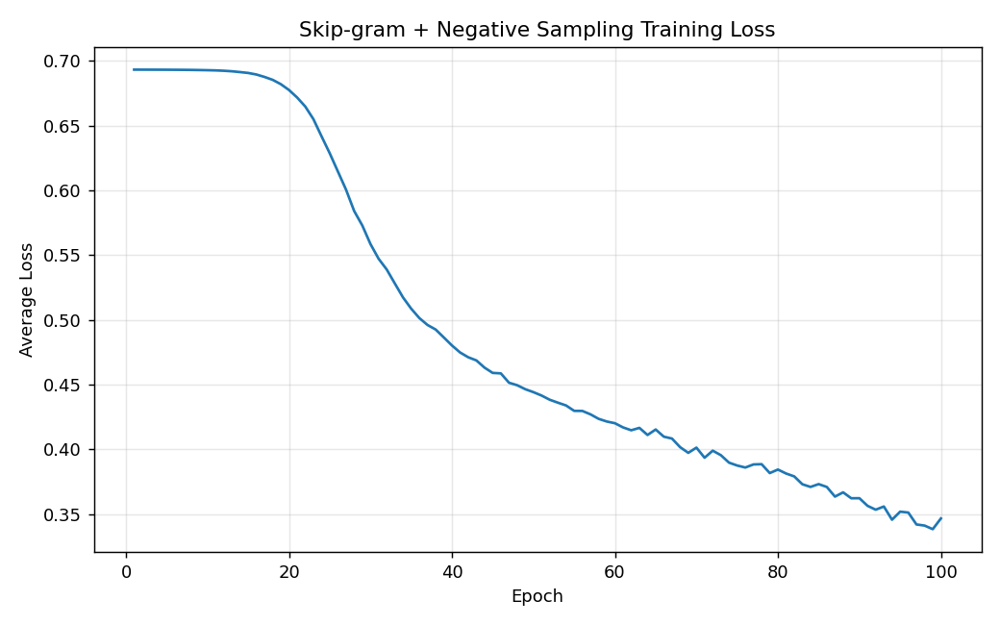
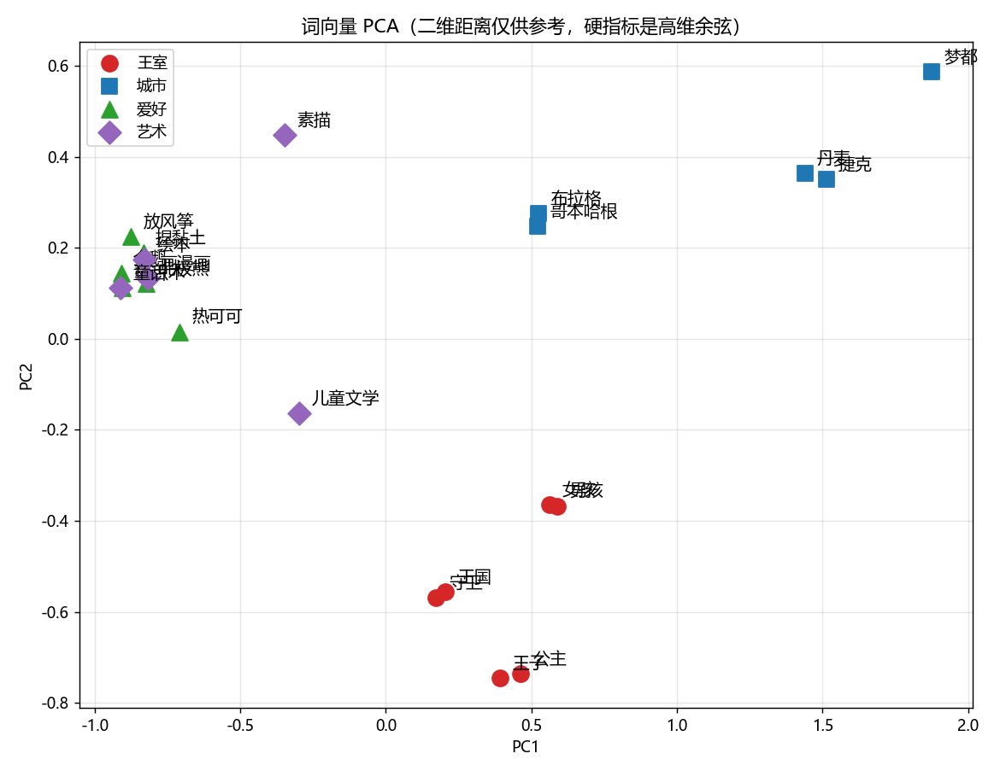

# NLP_word2vec

自然语言处理：**文本向量化 —— 用纯 NumPy 从零实现 Word2Vec（Skip-gram + 负采样）与词向量语义比较**。

不使用任何深度学习框架，手动完成从语料分词到词向量训练、语义相似度计算、PCA 可视化的完整流程。

## 实验内容

| 任务 | 内容 | 对应模块 |
| --- | --- | --- |
| 任务 1 | jieba 分词、构建词表、生成 Skip-gram 训练对 | `src/corpus.py` |
| 任务 2 | 从零实现 Skip-gram + 负采样训练 | `src/word2vec.py` |
| 任务 3 | 手写余弦相似度、相似词查询、语义比较 | `src/similarity.py` |
| 任务 4 | PCA 降维可视化词向量分组 | `src/visualize.py` |

## 目录结构

```
my_lab/
├── main.py            # 总入口：一条命令跑完全部 4 个任务
├── src/
│   ├── corpus.py      # 任务 1：读语料、分词、词表、训练对
│   ├── word2vec.py    # 任务 2：Skip-gram + 负采样（纯 NumPy）
│   ├── similarity.py  # 任务 3：余弦相似度与相似词查询
│   └── visualize.py   # 任务 4：PCA 二维散点图
├── data/
│   ├── corpus.txt     # 语料（童话奇幻主题，43 句，一行一句）
│   ├── user_dict.txt  # jieba 自定义词典（保证主题词不被切碎）
│   └── stopwords.txt  # 停用词表（仅在相似词查询时过滤）
├── outputs/           # 运行结果图片
└── requirements.txt
```

## 运行方法

```bash
pip install -r requirements.txt
python main.py
```

固定随机种子（`SEED = 42`），结果可复现。运行结束后 `outputs/` 下生成 `loss_curve.png` 与 `pca_words.png`。

## 超参数

| 参数 | 值 | 说明 |
| --- | --- | --- |
| `EMBED_DIM` | 50 | 词向量维度 |
| `WINDOW_SIZE` | 2 | Skip-gram 上下文窗口（句内滑动，不跨句） |
| `EPOCHS` | 100 | 训练轮数 |
| `LEARNING_RATE` | 0.01 | 学习率 |
| `NEGATIVE_SAMPLES` | 5 | 每个正样本配的负样本数 K |

## 实现要点

- **负采样噪声分布**：`P(w) ∝ freq(w)^0.75`，压低高频词、抬升低频词的采样概率。
- **初始化技巧**：输入侧 `W` 用小随机数打破对称，输出侧 `U` 全零，使初始 loss 恰为瞎猜基线 `ln2 ≈ 0.693`，便于验证训练是否有效。
- **梯度更新顺序**：先缓存 `W[center]`、`U[target]` 的副本再更新，避免第二步梯度用到被污染的向量。
- **查询用输入侧 W**：训练后取中心词向量（`W`）做相似度计算，而非输出侧 `U`。
- **PCA 只用被画的词估计主成分**：避免高频枢纽词（我/喜欢/很）主导方差方向，把语义组挤成一团。

## 实验结果

损失从瞎猜基线 `ln2 ≈ 0.693` 明显下降；语义比较中相关词对（如 王子-公主、哥本哈根-布拉格）的余弦相似度显著高于无关词对；PCA 可视化中四个语义主题（王室/城市/爱好/艺术）各自聚拢。

损失曲线：



词向量 PCA 分组：



## 致谢

实验指导与参考实现来自仓库 nlp-course 的 `chapter03/zhword2vec` 示例。
